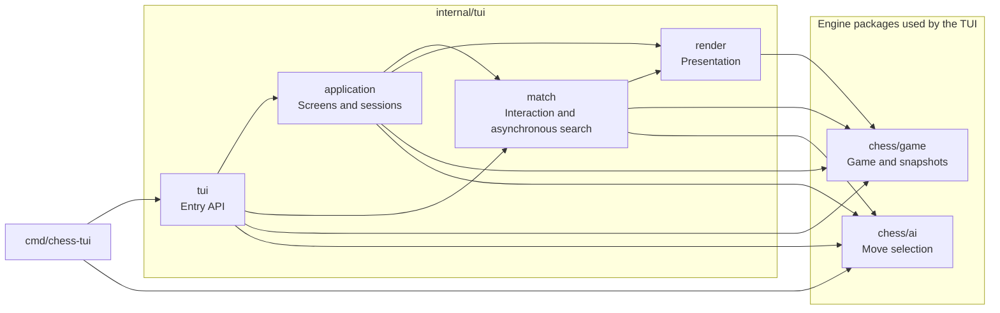
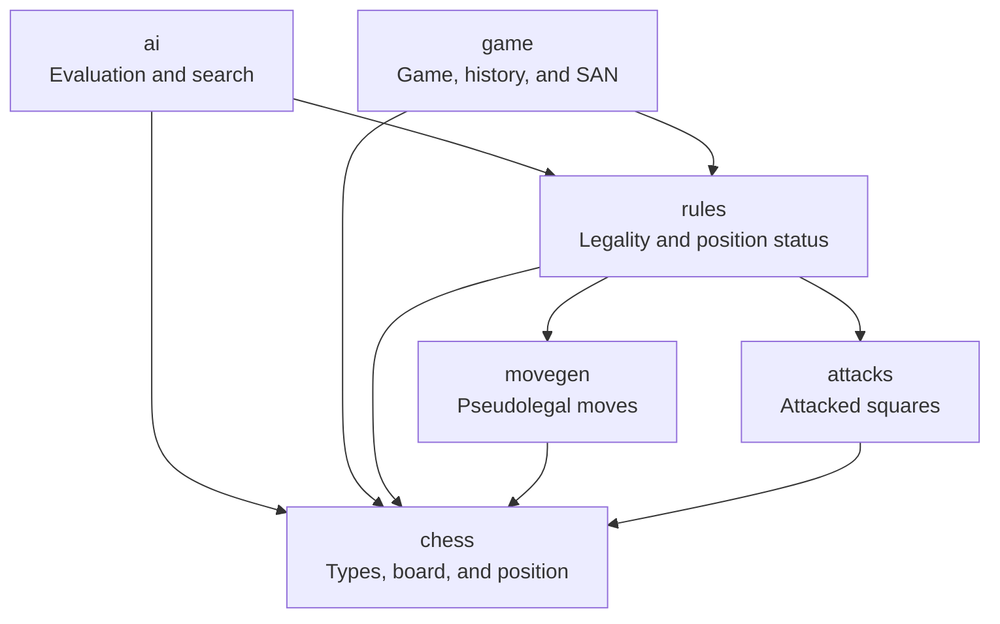

# Chess in Go

[Portuguese](README.md) | [English](README-EN.md)

A chess application written in Go with a terminal user interface (TUI) for two
local players or playing against the AI. It implements legal moves, check,
checkmate, stalemate, castling, en passant, and promotion with a choice of piece.
It also supports resignation and draws by agreement between local players.

The interface lets you select pieces, view legal destinations, and review
the history without changing the game. The engine includes rule and perft tests.

## Contents

- [Running](#running)
- [Tests](#tests)
- [Organization](#organization)
- [Implemented rules](#implemented-rules)
- [How the AI works](#how-the-ai-works)
- [Limitations](#limitations)
- [License](#license)

## Running

With [Task installed](https://taskfile.dev/docs/installation/), the main commands
are available from the project root:

```sh
task                         # list commands
task run                     # open the main menu
task ai                      # play against the AI on medium difficulty
task ai -- -ai hard -color black
task test                    # run tests
task vet                     # static analysis
task fmt                     # format code
task build                   # build executable in bin/
task check                   # run tests, analysis, and build in sequence
```

The Go commands below are also available without Task.

From the project root:

```sh
go run ./cmd/chess-tui
```

The menu lets you start a local game or configure the AI: choose your pieces
(white, black, or random) and the difficulty. After the result, you can play
again, inspect the board and history, or return to the menu. A rematch uses
the same settings; the random option draws a new color.

Commands with `-ai` start a game directly. To enter local mode directly,
use `go run ./cmd/chess-tui -ai off`.

To play as White against the AI:

```sh
go run ./cmd/chess-tui -ai medium
```

To play as Black, letting the AI move first:

```sh
go run ./cmd/chess-tui -ai hard -color black
```

| Option | Values | Default |
| --- | --- | --- |
| `-ai` | `off`, `easy`, `medium`, `hard`; starts without going through the menu | Without the flag: main menu |
| `-color` | `white`, `black`: your color against the AI | `white` |
| `-seed` | Integer used to break ties between AI moves | `1` |
| `-no-animation` | Disable animations | Animations enabled |

## Tests

CI runs tests, `go vet`, and builds on Windows and Linux.

All `*_test.go` files, including benchmarks, live in
`internal/chess/tests` or `internal/tui/tests`, grouped by subject.
Tests use the packages' public APIs; TUI flows are exercised through
keyboard events and rendered output.

```sh
go test ./...
go vet ./...
go test ./internal/chess/tests/ai -run '^$' -bench BenchmarkChooseMove -benchmem
```

### Controls

- In menus, ↑/↓ and Enter navigate and select; ←/→ change settings.
- During a game, arrow keys or WASD move the cursor; Enter selects or confirms a move.
- Esc: cancel selection/promotion; with nothing selected, open the game menu.
- In the game menu, resume, resign, or return to the main menu. In local mode,
  you can also offer a draw; declining it keeps the game going.
- F: flip the board orientation.
- ?: open help; Esc returns to the previous screen.
- H: open or close history review.
- During review, ←/A and →/D step through positions; Esc returns to the game.
- During promotion, ↑/↓ and Enter choose a piece; Q/R/B/N are shortcuts for queen,
  rook, bishop, or knight. Esc cancels without making the move.
- Q opens the game menu; in the main menu, it quits. Ctrl+C always quits.
- In the main menu, A toggles animations for the current run. Enter skips
  the opening animation without starting a game; press it again to select.
- While the AI is thinking, you can open the menu, help, or history. The search
  is canceled and restarts when you return to the game.
- If the AI fails, the screen lets you retry or return to the menu. Technical
  details are written to `chess-go/chess-go.log` inside the user's cache directory
  (`os.UserCacheDir`). If the log cannot be opened, the game continues without logging.

## Organization

```text
cmd/
└── chess-tui/          # application startup
internal/
├── chess/              # types, board, positions, and notation
│   ├── movegen/        # pseudolegal move generation
│   ├── attacks/        # attacked-square queries
│   ├── rules/          # legal moves and special rules
│   ├── game/           # game, snapshots, history, and SAN notation
│   ├── ai/             # evaluation and move search
│   └── tests/          # engine tests grouped by subject
└── tui/                # initialization and entry API
    ├── application/    # screens, navigation, and session lifecycle
    ├── match/          # game interaction, history, and AI
    ├── render/         # theme, components, and board
    └── tests/          # interface tests
```

### Interface and game control

`cmd/chess-tui` parses flags and calls the entry API in `tui`.
`application` coordinates screens and sessions; `match` controls game interaction
and the AI search lifecycle. `render` turns data into terminal content without
making moves or starting searches.

The arrows below represent internal imports. This view omits only imports of
the base `chess` package, which all five entry and interface packages use directly
(`cmd/chess-tui`, `tui`, `application`, `match`, and `render`).



The `tui` package also provides `NewModel` and `NewModelWithAI`, which expose
the `match` model without `application` screen navigation; this is why it imports
`match`, `game`, and `ai` directly. The executable imports `ai` to configure
difficulty. `render` imports `game` to display snapshots and results,
but does not depend on rules or search.

### Engine and rules

All names in this view belong to `internal/chess`. It shows all internal imports
of these packages, including dependencies on the base types.



The base `chess` package contains shared data and imports no other project
packages. `rules` filters moves and determines a position's status;
`game` maintains game state, results, and repetitions. `ai` simulates
positions according to the rules and returns a move without changing the actual game.

Each menu option keeps its label and action together in `application/menus.go`;
rendering and command execution use the same definition. Configuration keeps
typed difficulty values, and promotion choices come from the game's moves.
`match.State` provides copies of interaction data, while dimensions, colors,
components, and animation frames belong to `render`. SAN notation belongs to
`chess/game`, alongside the snapshots it describes; the renderer does not query rules.
The `application` package coordinates events, screens, and animation scheduling.

The engine does not import the TUI. `application`, `match`, and `render` do not
import the root `tui` package, and no production package imports tests. Tests live
in `tests` directories and depend on the public APIs of the packages they verify.

To inspect the actual imports, excluding dependencies used only by tests:

```sh
go list -f '{{.ImportPath}} {{.Imports}}' ./cmd/... ./internal/...
```

## Implemented rules

- Legal moves for all six piece types and alternating turns.
- Captures and protection of your own king from check.
- Check, checkmate, and draws by stalemate.
- Kingside and queenside castling.
- En passant.
- Promotion to queen, rook, bishop, or knight.
- Resignation and draws by agreement in local mode.

## How the AI works

The AI uses move search and an evaluation function written for this project.
It uses no training, neural networks, external services, or internet connection.

### 1. Position evaluation

A score estimates the advantage on the board. The unit is a centipawn:
100 points represent the material value of a pawn.

| Piece | Material value |
| --- | ---: |
| Pawn | 100 |
| Knight | 320 |
| Bishop | 330 |
| Rook | 500 |
| Queen | 900 |

Evaluation adds White's material and subtracts Black's. Positive values favor
White; negative values favor Black. Small bonuses reward knights, bishops,
and queens near the center, as well as central and advanced pawns.
The calculation mirrors positions to treat both colors equally.

The king has no capture value: the rules prevent its capture. The search
recognizes checkmate separately and gives it more weight than any material
advantage. It prefers faster mates and delays forced losses.
Stalemate scores zero, including at the search boundary.

### 2. Minimax and Negamax

The search simulates a tree: each position generates its legal moves, and each
move generates another position. Minimax assumes the opponent will choose their
best response. It therefore compares alternatives considering the worst response for us.

A simplified example, with scores from the choosing player's perspective:

| Alternative | Scores after possible opponent responses | Worst response |
| --- | --- | ---: |
| A | +300, -100 | -100 |
| B | +80, +40 | +40 |

The choice is B: the opponent's strongest response still leaves +40.
This is the idea behind [Minimax, described in UC Berkeley's AI material](https://inst.eecs.berkeley.edu/~cs188/textbook/games/minimax.html).

In this project, the algorithm uses the **Negamax** form: the score is viewed
from the side to move, and its sign is reversed when passing to the opponent.
This lets both colors share the same logic. The search deepens from 1 to the
selected depth, with a budget of two seconds per move. When the budget runs out,
it uses the last completed depth; if none finishes, it uses an already generated
legal move. Interface cancellations discard the result, even after a completed iteration.

### 3. Alpha-Beta pruning and move ordering

Alpha-Beta pruning stops analyzing a sequence when previously calculated bounds
show that it cannot improve the choice. It preserves the Minimax result at the
same depth and with the same evaluation while visiting fewer positions.
See [UC Berkeley's Alpha-Beta explanation](https://inst.eecs.berkeley.edu/~cs188/textbook/games/minimax.html#321-alpha-beta-pruning).

To find these bounds earlier, the search examines promotions and captures first,
prioritizing valuable victims captured by cheaper pieces. Move ordering includes
en passant. All simulations use the engine's rules, including castling,
en passant, promotion, and protection of your own king.

### 4. Difficulty levels and tie-breaking

Depth counts individual turns, called *plies*. A White move and a Black response
make up two plies.

| Difficulty | Depth | What it considers from the current position |
| --- | ---: | --- |
| Easy (`easy`) | 1 | AI move |
| Normal (`medium`) | 2 | AI move and opponent response |
| Hard (`hard`) | 3 | AI move, opponent response, and next AI move |

All three difficulty levels use the same evaluator. Increasing depth requires
more computation; these names do not correspond to an Elo rating.

When several moves have exactly the best score found, the AI breaks ties using
`-seed`. The same position, difficulty, and seed produce the same choice when
the same depth is completed within the budget. Changing the seed can vary ties;
it does not randomly select a move with a lower score. For example:

```sh
go run ./cmd/chess-tui -ai medium -seed 42
```

### 5. Relationship with the game and history

The search receives a complete copy of the position, including castling rights,
en passant, and counters. Simulating a sequence does not change the game or
record positions in its history. Only the chosen move is sent to the game
controller, which validates and records it like any other move.

Computation runs in the background while the TUI continues receiving keystrokes.
Opening the menu, help, or review, leaving the game, or quitting the program
cancels the search. Old results are associated with the session, request, and
original position, preventing them from changing another game or rematch.
The AI also chooses its promotion piece during search without asking the human player.

## Limitations

- The AI has limited depth and a simple evaluation: it can make mistakes and
  does not guarantee the best move in the game. A tactical sequence may continue
  beyond the search boundary, making an evaluation overly optimistic.
- Quiescence extends captures, en passant, promotions, and responses to check
  by up to eight additional plies. At that extension's boundary, it applies
  static evaluation; it can still miss longer tactics.
- There is no opening book or position cache. The two-second budget applies
  to deepening after the initial moves are generated; cancellation is
  cooperative and does not provide a real-time guarantee.
- The search recognizes insufficient material and the automatic 75-move limit,
  but does not receive repetition history; the game tracks those repetitions.
- Threefold repetition and the 50-move rule allow a draw claim in the current
  position through the game menu. The AI claims as soon as it can. Claims based
  on an intended move that has not yet been played are not supported.
- Fivefold repetition and 75 moves automatically end the game, preserving
  checkmate's priority. Insufficient material covers bare kings, a single bishop
  or knight, and positions with only bishops on the same square color in addition
  to the kings; other dead positions, such as complex blockades, are not detected.
  Reference: [FIDE rules, Articles 5 and 9](https://handbook.fide.com/chapter/e012023).
- History review lets you inspect previous positions without undoing moves
  or changing the game.
- There is no game saving or chess clock. Returning to the menu discards the game
  after confirmation; quitting the program does not save it either.
- Draw offers against the AI are unavailable: the engine does not yet have
  a policy for accepting or declining them.

## License

This project is distributed under the [MIT license](LICENSE).
