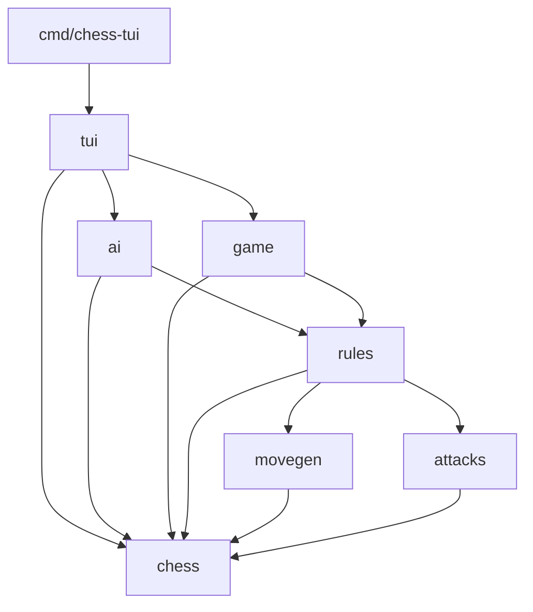

# chess-go

Aplicação de xadrez em Go com interface de terminal (TUI) para dois jogadores
locais ou para jogar contra a IA. Implementa movimentos legais, xeque,
xeque-mate, afogamento, roque, en passant e promoção com escolha da peça.

A interface permite selecionar peças, visualizar destinos legais e revisar
o histórico sem alterar a partida. O motor possui testes de regras e perft.

## Executar

Na raiz do projeto:

```sh
go run ./cmd/chess-tui
```

Para jogar de brancas contra a IA:

```sh
go run ./cmd/chess-tui -ai medium
```

Para jogar de pretas, deixando a IA começar:

```sh
go run ./cmd/chess-tui -ai hard -color black
```

| Opção | Valores | Padrão |
| --- | --- | --- |
| `-ai` | `off`, `easy`, `medium`, `hard` | `off`: dois jogadores locais |
| `-color` | `white`, `black`: sua cor contra a IA | `white` |
| `-seed` | Inteiro usado no desempate da IA | `1` |

### Controles

- Setas ou WASD: mover o cursor.
- Enter: selecionar uma peça ou executar a jogada.
- Esc: cancelar a seleção.
- H: abrir ou fechar a revisão do histórico.
- Na revisão, ←/A e →/D percorrem as posições; Esc retorna à partida.
- Na promoção, Q/R/B/N escolhem dama, torre, bispo ou cavalo.
- Q encerra fora da promoção; Ctrl+C encerra em qualquer modo.
- Durante o cálculo da IA, H pausa a busca e abre o histórico. Ao retornar,
  a busca recomeça na posição atual.
- Se a busca falhar, Enter tenta novamente, preservando a partida.

## Organização

```text

cmd/
└── chess-tui/          # inicialização da aplicação
internal/
├── chess/              # tipos, tabuleiro, posições e notação
│   ├── movegen/        # geração de movimentos pseudolegais
│   ├── attacks/        # consultas de casas atacadas
│   ├── rules/          # movimentos legais e regras especiais
│   ├── game/           # partida, snapshots e histórico
│   ├── ai/             # avaliação e busca de jogadas
│   └── tests/          # testes do motor separados por assunto
└── tui/                # teclado, renderização e revisão da partida
    └── tests/          # testes da interface
```

Os tipos compartilhados pertencem ao pacote `chess`, na raiz de
`internal/chess`. Os pacotes de comportamento usam esses tipos:



Uma seta representa um import. O pacote `chess` não importa os pacotes de
comportamento, evitando dependências circulares. Os testes importam os pacotes
que verificam; o motor não depende dos testes.

## Funções principais

| Pacote | Responsabilidade | Exemplos |
| --- | --- | --- |
| `chess` | Dados e notação | `Board`, `Piece`, `Move`, `ParseSquare` |
| `movegen` | Movimentos antes da filtragem de xeque | `PseudoLegalMoves`, `RookMoves`, `PawnMoves` |
| `attacks` | Casas atacadas, incluindo peças protegidas | `IsSquareAttacked` |
| `rules` | Validação de jogadas e situação da posição | `LegalMovesFrom`, `PositionAfterMove`, `EvaluateStatus` |
| `game` | Controle da partida e histórico | `NewGame`, `Play`, `Snapshot`, `HistorySnapshot` |
| `ai` | Avaliação e escolha de jogadas | `Evaluate`, `NewPlayer`, `ChooseMove` |
| `tui` | Interface de terminal | `Run`, `NewModel` |

## Regras implementadas

- Movimentos legais das seis peças e alternância de turnos.
- Capturas e proteção do próprio rei contra xeque.
- Xeque, xeque-mate e empate por afogamento.
- Roque pequeno e grande.
- En passant.
- Promoção para dama, torre, bispo ou cavalo.

## Como a IA funciona

A IA usa busca de jogadas e uma função de avaliação escrita no projeto.
Não utiliza treinamento, redes neurais, serviços externos ou conexão com a internet.

### 1. Avaliação da posição

Uma pontuação estima a vantagem no tabuleiro. A unidade é o centésimo de peão:
100 pontos representam o valor material de um peão.

| Peça | Valor material |
| --- | ---: |
| Peão | 100 |
| Cavalo | 320 |
| Bispo | 330 |
| Torre | 500 |
| Dama | 900 |

A avaliação soma o material das brancas e subtrai o das pretas. Valores positivos
favorecem as brancas; negativos favorecem as pretas. Pequenos bônus valorizam
cavalos, bispos e damas próximos do centro, além de peões centrais e avançados.
O cálculo espelha as posições para tratar as duas cores da mesma maneira.

O rei não recebe um preço de captura: as regras impedem sua captura. A busca
reconhece xeque-mate separadamente e atribui a ele uma importância maior que
qualquer vantagem material. Ela prefere mates mais rápidos e adia uma derrota
forçada. Afogamento recebe pontuação zero, inclusive no limite da busca.

### 2. Minimax e Negamax

A busca simula uma árvore: cada posição gera suas jogadas legais e cada jogada
gera outra posição. O Minimax supõe que o adversário escolherá a melhor resposta
para ele. Por isso, compara as alternativas considerando a pior resposta para nós.

Exemplo simplificado, com notas vistas pelo jogador que está escolhendo:

| Alternativa | Notas após possíveis respostas adversárias | Pior resposta |
| --- | --- | ---: |
| A | +300, -100 | -100 |
| B | +80, +40 | +40 |

A escolha é B: a resposta adversária mais forte ainda deixa +40.
Essa é a ideia do [Minimax, descrita no material de IA da UC Berkeley](https://inst.eecs.berkeley.edu/~cs188/textbook/games/minimax.html).

Neste projeto, o algoritmo é escrito na forma **Negamax**: a nota é vista por quem
tem a vez, e seu sinal é invertido ao passar para o adversário. Isso permite usar
a mesma lógica para as duas cores. Ao atingir a profundidade escolhida, uma
posição ainda em andamento recebe a avaliação de material e posicionamento.

### 3. Poda Alpha-Beta e ordenação

A poda Alpha-Beta interrompe a análise de uma sequência quando os limites já
calculados mostram que ela não pode melhorar a escolha. Ela preserva o resultado
do Minimax na mesma profundidade e com a mesma avaliação, visitando menos posições.
Veja a [explicação de Alpha-Beta da UC Berkeley](https://inst.eecs.berkeley.edu/~cs188/textbook/games/minimax.html#321-alpha-beta-pruning).

Para encontrar esses limites mais cedo, a busca examina primeiro promoções e
capturas, dando prioridade a vítimas valiosas capturadas por peças mais baratas.
A ordenação inclui en passant. Todas as simulações usam as regras do motor,
incluindo roque, en passant, promoção e proteção do próprio rei.

### 4. Dificuldades e desempate

A profundidade conta turnos individuais, chamados *plies*. Um movimento das
brancas e uma resposta das pretas correspondem a dois plies.

| Dificuldade | Profundidade | O que considera a partir da posição atual |
| --- | ---: | --- |
| `easy` | 1 | Jogada da IA |
| `medium` | 2 | Jogada da IA e resposta adversária |
| `hard` | 3 | Jogada da IA, resposta adversária e próxima jogada da IA |

As três dificuldades usam o mesmo avaliador. Aumentar a profundidade exige mais
cálculo; esses nomes não correspondem a uma classificação Elo.

Quando várias jogadas têm exatamente a melhor nota encontrada, a IA desempata
usando `-seed`. A mesma posição, dificuldade e seed produzem a mesma escolha.
Mudar a seed pode variar os empates; ela não escolhe aleatoriamente uma jogada
com nota inferior. Por exemplo:

```sh
go run ./cmd/chess-tui -ai medium -seed 42
```

### 5. Relação com a partida e o histórico

A busca recebe uma cópia completa da posição, incluindo direitos de roque,
en passant e contadores. Simular uma sequência não modifica a partida nem grava
posições no histórico. Somente a jogada escolhida é enviada ao controle da partida,
que a valida e a registra como qualquer outra jogada.

O cálculo roda em segundo plano enquanto a TUI continua recebendo teclas.
Ao abrir a revisão ou encerrar o programa, a busca recebe um cancelamento.
Resultados de buscas antigas são ignorados. A IA também escolhe a peça de
promoção durante a busca, sem solicitar uma escolha ao jogador humano.

## Limitações

- A IA tem profundidade limitada e avaliação simples: pode cometer erros e não
  garante a melhor jogada da partida. Uma sequência tática pode continuar além
  do limite pesquisado e tornar uma avaliação otimista demais.
- Não há busca adicional de capturas no limite de profundidade (*quiescence*),
  livro de aberturas ou cache de posições. A dificuldade `hard` pode demorar mais
  em posições com muitas alternativas; não há limite fixo de tempo por jogada.
- Empates por repetição, regra dos 50 movimentos e material insuficiente
  ainda não são detectados.
- A revisão do histórico permite consultar posições anteriores sem
  desfazer jogadas ou modificar a partida.

## Testes

```sh
go test ./...
go vet ./...
```
