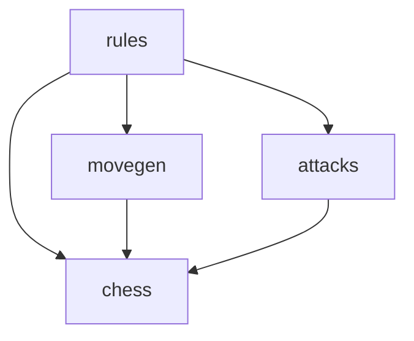

# chess-go

Motor de xadrez em Go. O projeto implementa movimentos básicos das seis peças,
detecção de ataques e xeque, filtragem de movimentos legais, xeque-mate e
afogamento. As regras especiais fazem parte da próxima etapa do desenvolvimento.

## Organização

```text
cmd/
└── chess-cli/                 # entrada da futura interface de terminal
internal/
└── chess/
    ├── types.go              # cores, peças, status e direções
    ├── board.go              # tabuleiro e acesso às casas
    ├── square.go             # casas e conversão de notação
    ├── move.go               # representação e notação de movimentos
    ├── errors.go             # erros compartilhados
    ├── movegen/
    │   ├── generator.go      # helpers e seleção do gerador
    │   └── pieces.go         # movimentos básicos das seis peças
    ├── attacks/
    │   ├── query.go          # consulta de ataques por cor
    │   └── pieces.go         # geometria dos ataques e bloqueios
    ├── rules/
    │   ├── moves.go          # simulação e filtragem de movimentos legais
    │   ├── check.go          # localização dos reis e detecção de xeque
    │   └── status.go         # andamento, xeque-mate e afogamento
    └── tests/
        ├── model/            # tabuleiro, casas e notação
        ├── movegen/          # geradores, movimentos em linha, saltos e peões
        ├── attacks/          # geometria, ataques em linha e consultas
        └── rules/            # simulação, xeque, movimentos legais e status
```

Os tipos compartilhados pertencem ao pacote `chess`, na raiz de
`internal/chess`. Os pacotes de comportamento usam esses tipos:



Uma seta representa um import. O pacote `chess` não importa os pacotes de
comportamento, evitando dependências circulares. Os testes importam os pacotes
que verificam; o motor não depende dos testes.

## Funções principais

| Pacote | Responsabilidade | Exemplos |
| --- | --- | --- |
| `chess` | Dados e notação | `Board`, `Piece`, `Move`, `ParseSquare` |
| `movegen` | Movimentos antes da filtragem de xeque | `PseudoLegalMoves`, `RookMoves`, `PawnMoves` |
| `attacks` | Casas atacadas, incluindo peças protegidas | `IsSquareAttacked` |
| `rules` | Segurança do rei e situação da partida | `LegalMoves`, `IsInCheck`, `HasLegalMove`, `EvaluateStatus` |

Funções usadas entre pacotes começam com letra maiúscula. Por exemplo:

```go
import (
    "github.com/gabrzb/chess-go/internal/chess"
    "github.com/gabrzb/chess-go/internal/chess/rules"
)

// board é um chess.Board já montado.
moves, err := rules.LegalMoves(board, chess.E2)
```

`BoardAfterMove` simula um movimento em uma cópia do tabuleiro. A geração e a
filtragem das jogadas são feitas por `movegen` e `rules.LegalMoves`.

## Casas e coordenadas

As 64 casas t?m constantes tipadas no pacote `chess`: `A1` at? `H8`.
Use os nomes ao montar tabuleiros e movimentos:

```go
move := chess.Move{From: chess.E2, To: chess.E4}
destination, ok := chess.E2.Offset(0, 1) // E3, true
```

`BoardSize` define a quantidade de linhas e colunas, e `SquareCount` define
quantas casas existem. `Column()` e `Row()` retornam ?ndices a partir de zero;
para casas inv?lidas, retornam `-1`. `Offset()` verifica os limites e devolve
`NoSquare, false` quando a origem ? inv?lida ou o deslocamento sai do tabuleiro.
Essas defini??es pertencem ao pacote `chess`, junto de `Square` e `Board`.

## Testes

Os testes ficam agrupados por assunto em `internal/chess/tests`. Os 87 testes
existentes foram preservados durante a separação dos pacotes.

Execute tudo na raiz do projeto:

```sh
go test ./...
go vet ./...
```

Para executar somente uma área:

```sh
go test ./internal/chess/tests/rules/...
go test ./internal/chess/tests/movegen/...
```
