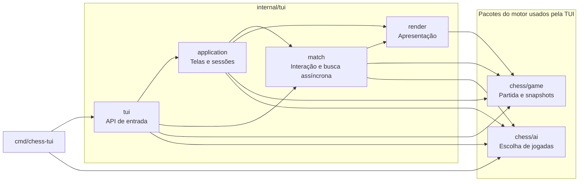
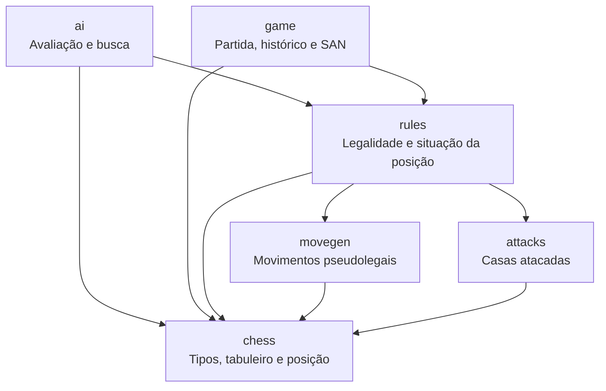

# chess-go

Aplicação de xadrez em Go com interface de terminal (TUI) para dois jogadores
locais ou para jogar contra a IA. Implementa movimentos legais, xeque,
xeque-mate, afogamento, roque, en passant e promoção com escolha da peça.
Também permite desistência e empate por acordo entre jogadores locais.

A interface permite selecionar peças, visualizar destinos legais e revisar
o histórico sem alterar a partida. O motor possui testes de regras e perft.

## Sumário

- [Executar](#executar)
- [Organização](#organização)
- [Funções principais](#funções-principais)
- [Regras implementadas](#regras-implementadas)
- [Como a IA funciona](#como-a-ia-funciona)
- [Limitações](#limitações)
- [Testes](#testes)
- [Licença](#licença)

## Executar

Com o [Task instalado](https://taskfile.dev/docs/installation/), os comandos
principais ficam disponíveis na raiz do projeto:

```sh
task                         # listar comandos
task run                     # abrir o menu principal
task ai                      # contra a IA em dificuldade média
task ai -- -ai hard -color black
task test                    # testes
task vet                     # análise estática
task fmt                     # formatação
task build                   # executável em bin/
task check                   # testes, análise e compilação em sequência
```

Os comandos Go abaixo continuam disponíveis sem o Task.

Na raiz do projeto:

```sh
go run ./cmd/chess-tui
```

O menu permite iniciar uma partida local ou configurar a IA: escolha suas peças
(brancas, pretas ou aleatório) e a dificuldade. Após o resultado, é possível jogar
novamente, consultar o tabuleiro e o histórico ou voltar ao menu. A revanche usa
as mesmas configurações; a opção aleatória faz um novo sorteio.

Os comandos com `-ai` iniciam diretamente a partida. Para entrar diretamente no
modo local, use `go run ./cmd/chess-tui -ai off`.

Para jogar de brancas contra a IA:

```sh
go run ./cmd/chess-tui -ai medium
```

Para jogar de pretas, deixando a IA começar:

```sh
go run ./cmd/chess-tui -ai hard -color black
```

| Opção | Valores | Padrão |
| --- | --- | --- |
| `-ai` | `off`, `easy`, `medium`, `hard`; inicia sem passar pelo menu | Sem a flag: menu principal |
| `-color` | `white`, `black`: sua cor contra a IA | `white` |
| `-seed` | Inteiro usado no desempate da IA | `1` |
| `-no-animation` | Desativar animações | Animações ligadas |

O tabuleiro fica centralizado, com turno, último lance e histórico distribuídos
acima dele. Os lances são agrupados por cor em notação algébrica (SAN). O cursor
usa apenas uma seta (`▸`), sem pintar linhas nem alterar o fundo das casas.
A seleção usa `●` e os destinos legais usam `·`. Nos menus, somente a seta recebe
a cor de foco. As casas alternam cores e as peças têm cores próprias para brancas
e pretas. Casas de 2×1 ou 4×2 caracteres preservam a proporção aproximada de
quadrados em fontes de terminal usuais. Um quadrante ao lado do tabuleiro mostra
a cor da vez; ao revisar o histórico, acompanha a posição exibida. Ao encerrar a
partida, fica neutro e informa o encerramento. Janelas menores usam o layout
compacto; se o tabuleiro não couber, a interface pede para ampliar a janela e
preserva a posição. As peças requerem
uma fonte com suporte aos símbolos Unicode de xadrez.

### Controles

- Nos menus, ↑/↓ e Enter navegam e selecionam; ←/→ alteram as configurações.
- Na partida, setas ou WASD movem o cursor; Enter seleciona ou confirma a jogada.
- Esc: cancelar seleção/promoção; sem seleção, abrir o menu da partida.
- No menu da partida, continuar, desistir ou voltar ao menu principal. No modo
  local, também oferecer empate; recusar mantém a partida.
- F: inverter a orientação do tabuleiro.
- ?: abrir a ajuda; Esc retorna à tela anterior.
- H: abrir ou fechar a revisão do histórico.
- Na revisão, ←/A e →/D percorrem as posições; Esc retorna à partida.
- Na promoção, ↑/↓ e Enter escolhem a peça; Q/R/B/N são atalhos para dama,
  torre, bispo ou cavalo. Esc cancela sem executar o movimento.
- Q abre o menu da partida; no menu principal, encerra. Ctrl+C encerra sempre.
- No menu principal, A liga ou desliga animações nesta execução. Enter pula
  a abertura sem iniciar uma partida; pressione novamente para selecionar.
- Durante o cálculo da IA, é possível abrir menu, ajuda ou histórico. A busca
  é cancelada e recomeça ao retornar à partida.
- Se a IA falhar, a tela permite tentar novamente ou voltar ao menu. Detalhes
  técnicos ficam em `chess-go/chess-go.log`, dentro da pasta de cache do usuário
  (`os.UserCacheDir`). Se o log não puder ser aberto, o jogo continua sem gravá-lo.

## Organização

```text
cmd/
└── chess-tui/          # inicialização da aplicação
internal/
├── chess/              # tipos, tabuleiro, posições e notação
│   ├── movegen/        # geração de movimentos pseudolegais
│   ├── attacks/        # consultas de casas atacadas
│   ├── rules/          # movimentos legais e regras especiais
│   ├── game/           # partida, snapshots, histórico e notação SAN
│   ├── ai/             # avaliação e busca de jogadas
│   └── tests/          # testes do motor separados por assunto
└── tui/                # inicialização e API de entrada
    ├── application/    # telas, navegação e ciclo das sessões
    ├── match/          # interação com a partida, histórico e IA
    ├── render/         # tema, componentes e tabuleiro
    └── tests/          # testes da interface
```

### Interface e controle da partida

`cmd/chess-tui` interpreta as flags e chama a API de entrada em `tui`.
`application` coordena as telas e as sessões; `match` controla a interação com
a partida e o ciclo de busca da IA. `render` transforma dados em conteúdo de
terminal, sem executar jogadas ou iniciar buscas.

As setas abaixo representam imports internos. A vista omite somente os imports
do pacote base `chess`, usado diretamente por todos os cinco pacotes de entrada
e interface (`cmd/chess-tui`, `tui`, `application`, `match` e `render`).



O pacote `tui` também oferece `NewModel` e `NewModelWithAI`, que expõem o modelo
de `match` sem a navegação de telas de `application`; por isso ele importa
`match`, `game` e `ai` diretamente. O import de `ai` no executável serve à
configuração da dificuldade. `render` importa `game` para apresentar snapshots
e resultados, mas não depende das regras nem da busca.

### Motor e regras

Todos os nomes desta vista pertencem a `internal/chess`. Aqui estão todos os
imports internos desses pacotes, incluindo as dependências dos tipos base.



O pacote base `chess` contém os dados compartilhados e não importa outros pacotes
do projeto. `rules` filtra movimentos e determina a situação de uma posição;
`game` mantém o estado da partida, os resultados e as repetições. `ai` simula
posições pelas regras e devolve uma jogada, sem modificar a partida real.

Cada opção de menu reúne seu rótulo e sua ação em `application/menus.go`;
o desenho e o comando executado usam a mesma definição. A configuração mantém
dificuldades tipadas, e as escolhas de promoção vêm dos movimentos da partida.
`match.State` fornece cópias dos dados de interação, enquanto medidas, cores,
componentes e quadros de animação pertencem a `render`. A notação SAN pertence a
`chess/game`, junto dos snapshots que descreve; o renderer não consulta regras.
O pacote `application` coordena eventos, telas e o agendamento das animações.

O motor não importa a TUI. `application`, `match` e `render` não importam a raiz
`tui`, e nenhum pacote de produção importa os testes. Os testes ficam nas pastas
`tests` e dependem das APIs públicas dos pacotes que verificam.

Para conferir os imports reais, sem incluir dependências exclusivas dos testes:

```sh
go list -f '{{.ImportPath}} {{.Imports}}' ./cmd/... ./internal/...
```

## Funções principais

| Pacote | Responsabilidade | Exemplos |
| --- | --- | --- |
| `chess` | Tipos base e coordenadas | `Board`, `Piece`, `Move`, `Position`, `ParseSquare` |
| `movegen` | Movimentos antes da filtragem de xeque | `PseudoLegalMoves`, `RookMoves`, `PawnMoves` |
| `attacks` | Casas atacadas, incluindo peças protegidas | `IsSquareAttacked` |
| `rules` | Validação de jogadas e situação da posição | `LegalMovesFrom`, `PositionAfterMove`, `EvaluateStatus` |
| `game` | Partida, resultado, histórico e SAN | `NewGame`, `Play`, `Snapshot`, `HistorySnapshot`, `ClaimDraw`, `SAN` |
| `ai` | Avaliação e escolha de jogadas | `Evaluate`, `NewPlayer`, `ChooseMove` |
| `tui` | Inicialização e API de entrada | `Run`, `RunWithOptions`, `NewApplication` |
| `tui/application` | Telas, navegação e sessões | `New`, `Options` |
| `tui/match` | Interação com a partida e ciclo da IA | `New`, `State`, `StartAI`, `StopAI` |
| `tui/render` | Composição visual e layout | `Window`, `Match`, `Board`, `Turn`, `Menu` |

## Regras implementadas

- Movimentos legais das seis peças e alternância de turnos.
- Capturas e proteção do próprio rei contra xeque.
- Xeque, xeque-mate e empate por afogamento.
- Roque pequeno e grande.
- En passant.
- Promoção para dama, torre, bispo ou cavalo.
- Desistência e empate por acordo no modo local.

## Como a IA funciona

A IA usa busca de jogadas e uma função de avaliação escrita no projeto.
Não utiliza treinamento, redes neurais, serviços externos ou conexão com a internet.

### 1. Avaliação da posição

Uma pontuação estima a vantagem no tabuleiro. A unidade é o centésimo de peão:
100 pontos representam o valor material de um peão.

| Peça | Valor material |
| --- | ---: |
| Peão | 100 |
| Cavalo | 320 |
| Bispo | 330 |
| Torre | 500 |
| Dama | 900 |

A avaliação soma o material das brancas e subtrai o das pretas. Valores positivos
favorecem as brancas; negativos favorecem as pretas. Pequenos bônus valorizam
cavalos, bispos e damas próximos do centro, além de peões centrais e avançados.
O cálculo espelha as posições para tratar as duas cores da mesma maneira.

O rei não recebe um preço de captura: as regras impedem sua captura. A busca
reconhece xeque-mate separadamente e atribui a ele uma importância maior que
qualquer vantagem material. Ela prefere mates mais rápidos e adia uma derrota
forçada. Afogamento recebe pontuação zero, inclusive no limite da busca.

### 2. Minimax e Negamax

A busca simula uma árvore: cada posição gera suas jogadas legais e cada jogada
gera outra posição. O Minimax supõe que o adversário escolherá a melhor resposta
para ele. Por isso, compara as alternativas considerando a pior resposta para nós.

Exemplo simplificado, com notas vistas pelo jogador que está escolhendo:

| Alternativa | Notas após possíveis respostas adversárias | Pior resposta |
| --- | --- | ---: |
| A | +300, -100 | -100 |
| B | +80, +40 | +40 |

A escolha é B: a resposta adversária mais forte ainda deixa +40.
Essa é a ideia do [Minimax, descrita no material de IA da UC Berkeley](https://inst.eecs.berkeley.edu/~cs188/textbook/games/minimax.html).

Neste projeto, o algoritmo é escrito na forma **Negamax**: a nota é vista por quem
tem a vez, e seu sinal é invertido ao passar para o adversário. Isso permite usar
a mesma lógica para as duas cores. A busca aprofunda de 1 até a profundidade
escolhida, com orçamento de dois segundos por jogada. Ao esgotar o orçamento,
usa a última profundidade concluída;
se nenhuma terminar, usa uma jogada legal já gerada. Cancelamentos da interface
descartam o resultado, inclusive após uma iteração concluída.

### 3. Poda Alpha-Beta e ordenação

A poda Alpha-Beta interrompe a análise de uma sequência quando os limites já
calculados mostram que ela não pode melhorar a escolha. Ela preserva o resultado
do Minimax na mesma profundidade e com a mesma avaliação, visitando menos posições.
Veja a [explicação de Alpha-Beta da UC Berkeley](https://inst.eecs.berkeley.edu/~cs188/textbook/games/minimax.html#321-alpha-beta-pruning).

Para encontrar esses limites mais cedo, a busca examina primeiro promoções e
capturas, dando prioridade a vítimas valiosas capturadas por peças mais baratas.
A ordenação inclui en passant. Todas as simulações usam as regras do motor,
incluindo roque, en passant, promoção e proteção do próprio rei.

### 4. Dificuldades e desempate

A profundidade conta turnos individuais, chamados *plies*. Um movimento das
brancas e uma resposta das pretas correspondem a dois plies.

| Dificuldade | Profundidade | O que considera a partir da posição atual |
| --- | ---: | --- |
| Fácil (`easy`) | 1 | Jogada da IA |
| Normal (`medium`) | 2 | Jogada da IA e resposta adversária |
| Difícil (`hard`) | 3 | Jogada da IA, resposta adversária e próxima jogada da IA |

As três dificuldades usam o mesmo avaliador. Aumentar a profundidade exige mais
cálculo; esses nomes não correspondem a uma classificação Elo.

Quando várias jogadas têm exatamente a melhor nota encontrada, a IA desempata
usando `-seed`. A mesma posição, dificuldade e seed produzem a mesma escolha quando a mesma
profundidade é concluída dentro do orçamento.
Mudar a seed pode variar os empates; ela não escolhe aleatoriamente uma jogada
com nota inferior. Por exemplo:

```sh
go run ./cmd/chess-tui -ai medium -seed 42
```

### 5. Relação com a partida e o histórico

A busca recebe uma cópia completa da posição, incluindo direitos de roque,
en passant e contadores. Simular uma sequência não modifica a partida nem grava
posições no histórico. Somente a jogada escolhida é enviada ao controle da partida,
que a valida e a registra como qualquer outra jogada.

O cálculo roda em segundo plano enquanto a TUI continua recebendo teclas.
Ao abrir menu, ajuda ou revisão, abandonar a partida ou encerrar o programa,
a busca recebe um cancelamento. Resultados antigos são associados à sessão,
ao pedido e à posição original, impedindo que alterem outra partida ou revanche.
A IA também escolhe a peça de
promoção durante a busca, sem solicitar uma escolha ao jogador humano.

## Limitações

- A IA tem profundidade limitada e avaliação simples: pode cometer erros e não
  garante a melhor jogada da partida. Uma sequência tática pode continuar além
  do limite pesquisado e tornar uma avaliação otimista demais.
- A quiescência estende capturas, en passant, promoções e respostas a xeque
  por até oito plies adicionais. No limite dessa extensão, aplica a avaliação
  estática; ainda pode perder táticas mais longas.
- Não há livro de aberturas nem cache de posições. O orçamento de dois segundos
  vale para o aprofundamento após gerar as jogadas iniciais; o cancelamento é
  cooperativo e não constitui uma garantia de tempo real.
- A busca reconhece material insuficiente e o limite automático de 75 movimentos,
  mas não recebe o histórico de repetições; a partida controla essas repetições.
- Repetição tripla e regra dos 50 movimentos permitem reivindicar empate na
  posição atual pelo menu da partida. A IA reivindica assim que pode. Não há
  reivindicação antecipada indicando um lance ainda não executado.
- Repetição quíntupla e 75 movimentos encerram automaticamente a partida,
  preservando a prioridade do xeque-mate. Material insuficiente cobre reis
  sozinhos, um único bispo ou cavalo e somente bispos da mesma cor de casas;
  outras posições mortas, como bloqueios complexos, não são detectadas.
  Referência: [regras da FIDE, artigos 5 e 9](https://handbook.fide.com/chapter/e012023).
- A revisão do histórico permite consultar posições anteriores sem
  desfazer jogadas ou modificar a partida.
- Não há salvamento de partidas nem relógio. Voltar ao menu descarta a partida
  após confirmação; encerrar o programa também não a salva.
- Oferta de empate contra a IA não está disponível: o motor ainda não possui
  uma política para aceitar ou recusar.

## Testes

O CI executa testes, `go vet` e compilação no Windows e no Linux.

Todos os arquivos `*_test.go`, incluindo benchmarks, ficam em
`internal/chess/tests` ou `internal/tui/tests`, separados por assunto.
Os testes usam as APIs públicas dos pacotes; os fluxos da TUI são exercitados
por eventos de teclado e pela saída renderizada.

```sh
go test ./...
go vet ./...
go test ./internal/chess/tests/ai -run '^$' -bench BenchmarkChooseMove -benchmem
```

## Licença

Este projeto é distribuído sob a [licença MIT](LICENSE).
