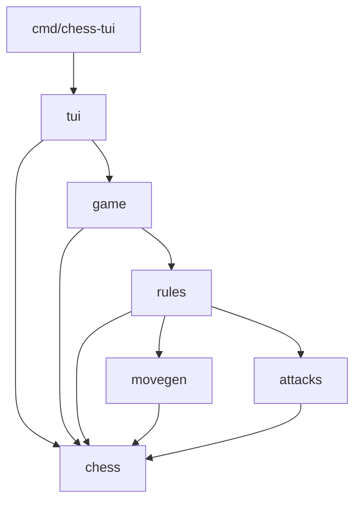

# chess-go

Aplicação de xadrez em Go com interface de terminal (TUI) para dois jogadores
locais. Implementa movimentos legais, xeque, xeque-mate, afogamento, roque,
en passant e promoção com escolha da peça.

A interface permite selecionar peças, visualizar destinos legais e revisar
o histórico sem alterar a partida. O motor possui testes de regras e perft.

## Executar

Na raiz do projeto:

```sh
go run ./cmd/chess-tui
```

### Controles

- Setas ou WASD: mover o cursor.
- Enter: selecionar uma peça ou executar a jogada.
- Esc: cancelar a seleção.
- H: abrir ou fechar a revisão do histórico.
- Na revisão, ←/A e →/D percorrem as posições; Esc retorna à partida.
- Na promoção, Q/R/B/N escolhem dama, torre, bispo ou cavalo.
- Q encerra fora da promoção; Ctrl+C encerra em qualquer modo.

## Organização

```text

cmd/
└── chess-tui/          # inicialização da aplicação
internal/
├── chess/              # tipos, tabuleiro, posições e notação
│   ├── movegen/        # geração de movimentos pseudolegais
│   ├── attacks/        # consultas de casas atacadas
│   ├── rules/          # movimentos legais e regras especiais
│   ├── game/           # partida, snapshots e histórico
│   └── tests/          # testes do motor separados por assunto
└── tui/                # teclado, renderização e revisão da partida
    └── tests/          # testes da interface
```

Os tipos compartilhados pertencem ao pacote `chess`, na raiz de
`internal/chess`. Os pacotes de comportamento usam esses tipos:



Uma seta representa um import. O pacote `chess` não importa os pacotes de
comportamento, evitando dependências circulares. Os testes importam os pacotes
que verificam; o motor não depende dos testes.

## Funções principais

| Pacote | Responsabilidade | Exemplos |
| --- | --- | --- |
| `chess` | Dados e notação | `Board`, `Piece`, `Move`, `ParseSquare` |
| `movegen` | Movimentos antes da filtragem de xeque | `PseudoLegalMoves`, `RookMoves`, `PawnMoves` |
| `attacks` | Casas atacadas, incluindo peças protegidas | `IsSquareAttacked` |
| `rules` | Validação de jogadas e situação da posição | `LegalMovesFrom`, `PositionAfterMove`, `EvaluateStatus` |
| `game` | Controle da partida e histórico | `NewGame`, `Play`, `Snapshot`, `HistorySnapshot` |
| `tui` | Interface de terminal | `Run`, `NewModel` |

## Regras implementadas

- Movimentos legais das seis peças e alternância de turnos.
- Capturas e proteção do próprio rei contra xeque.
- Xeque, xeque-mate e empate por afogamento.
- Roque pequeno e grande.
- En passant.
- Promoção para dama, torre, bispo ou cavalo.

## Limitações

- Partidas entre dois jogadores locais; ainda não há adversário com IA.
- Empates por repetição, regra dos 50 movimentos e material insuficiente
  ainda não são detectados.
- A revisão do histórico permite consultar posições anteriores sem
  desfazer jogadas ou modificar a partida.

## Testes

```sh
go test ./...
go vet ./...
```
