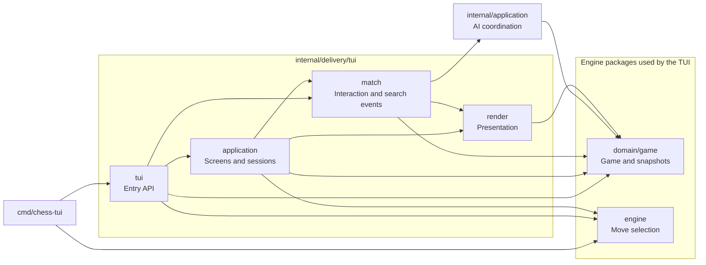
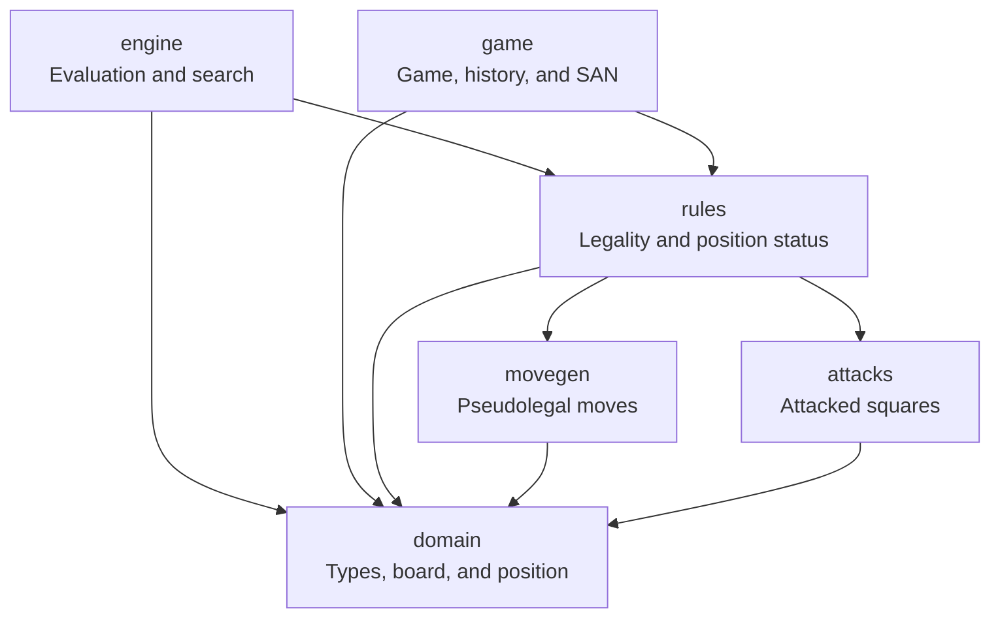

# Organization

[Documentation](README.md)

```text
cmd/
└── chess-tui/          # CLI entry point
internal/
├── application/        # UI-independent AI coordination
│   └── tests/          # search lifecycle tests
├── architecture/
│   └── tests/          # package dependency checks
├── domain/             # pure chess types and rules; standard library only
│   ├── movegen/        # pseudolegal moves
│   ├── attacks/        # attacked squares
│   ├── rules/          # legal moves and position transitions
│   ├── game/           # game, snapshots, history and SAN
│   └── tests/          # domain tests
├── engine/             # AI evaluation and search
│   └── tests/          # search tests and benchmarks
└── delivery/
    └── tui/            # terminal interface and entry API
        ├── application/ # screens and sessions
        ├── match/       # interaction and search event adapter
        ├── render/      # presentation
        └── tests/       # interface tests
```

### Interface and game control

`cmd/chess-tui` parses flags and calls the entry API in `tui`.
`delivery/tui/application` coordinates screens and sessions; `match` controls game
interaction and adapts search events. `internal/application.Opponent` coordinates
the AI lifecycle independently of Bubble Tea. `render` turns data into terminal content without
making moves or starting searches.

The arrows below represent internal imports. This view omits only imports of
the base `domain` package, used directly by the entry, interface, and AI
coordination packages.



The `tui` package also provides `NewModel` and `NewModelWithAI`, which expose
the `match` model without `application` screen navigation; this is why it imports
`match` and `game` directly. Both `tui` and the executable import `engine` to
configure difficulty. `render` imports `game` to display snapshots and results,
but does not depend on rules or search.

`domain.MoveChooser` defines `ChooseMove(context.Context, Position)`.
`engine.Player` implements this contract; `tui.NewModelWithAI` accepts any
implementation, including custom strategies. `internal/application.Opponent`
applies results through `Game.Play`, which validates moves before changing the game.
The `match` package does not import `engine`.

`Opponent.Start` returns a search function for background execution;
`Start`, `Stop`, and `Accept` must run on the interface's event loop.
The coordinator cancels searches and discards duplicate results, older searches,
and results from other sessions. The TUI decides when to pause for history, menus,
or promotion and adapts the search function to `tea.Cmd`. The application layer
depends only on the domain and standard library; it starts no goroutines and
contains no display messages.

`Board` owns a fixed array and `Position` contains only values: copying a position
copies all 64 squares without allocating slices or sharing pointers.
`rules.PositionAfterMove` validates and returns a new position. Search uses
`PositionAfterLegalMove` only with legal moves generated for that exact position.

`NewPosition` builds editable positions. `Position.Validate` checks pieces, kings,
counters, castling rights, and en passant metadata; it does not prove reachability
through legal play. The engine validates input once before searching, without
repeating this check for every simulated position.

### Engine and rules

All names in this view belong to `internal/domain` and `internal/engine`. It shows all internal imports
of these packages, including dependencies on the base types.



The base `domain` package contains shared data and imports no other project
packages. `rules` filters moves and determines a position's status;
`game` maintains game state, results, and repetitions. `engine` simulates
positions according to the rules and returns a move without changing the actual game.

Each menu option keeps its label and action together in `application/menus.go`;
rendering and command execution use the same definition. Configuration keeps
typed difficulty values, and promotion choices come from the game's moves.
`match.State` provides copies of interaction data, while dimensions, colors,
components, and animation frames belong to `render`. SAN notation belongs to
`domain/game`, alongside the snapshots it describes; the renderer does not query rules.
The `delivery/tui/application` package coordinates events, screens, and animation scheduling.

The engine does not import the TUI. `application`, `match`, and `render` do not
import the root `tui` package, and no production package imports tests. Tests live
in `tests` directories and depend on the public APIs of the packages they verify.

`internal/architecture/tests` checks imports in every production Go file,
including files targeting other platforms. It protects the boundaries above
and requires declaring dependencies for new packages. It runs with
`go test ./...`, including CI, without additional tools.

To inspect the actual imports, excluding dependencies used only by tests:

```sh
go list -f '{{.ImportPath}} {{.Imports}}' ./cmd/... ./internal/...
```
