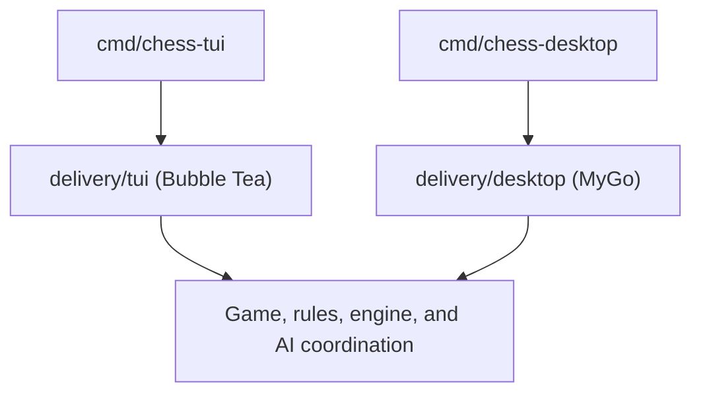
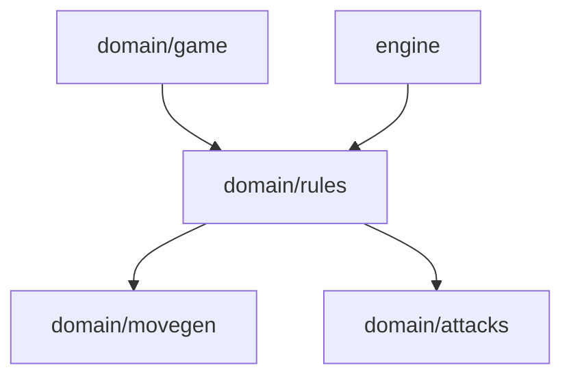

# Organization

[Documentation](README.md)

```text
cmd/
├── chess-tui/          # terminal entry point
└── chess-desktop/      # native desktop entry point
internal/
├── application/        # UI-independent AI coordination
│   └── tests/          # search lifecycle tests
├── architecture/
│   └── tests/          # package dependency checks
├── domain/             # pure chess types and rules; standard library only
│   ├── movegen/        # pseudolegal moves
│   ├── attacks/        # attacked squares
│   ├── rules/          # legal moves and position transitions
│   ├── game/           # game, snapshots, history and SAN
│   └── tests/          # domain tests
├── engine/             # AI evaluation and search
│   └── tests/          # search tests and benchmarks
└── delivery/
    ├── tui/            # Bubble Tea terminal interface
    │   ├── application/ # screens and sessions
    │   ├── match/       # interaction and search event adapter
    │   ├── render/      # presentation
    │   └── tests/       # interface tests
    └── desktop/        # MyGo native window and entry API
        ├── pages/      # screen selection and composition
        ├── components/ # widgets and interaction state
        └── tests/      # desktop interface tests
```

## Interfaces and shared core



Each executable parses flags and calls its interface package. The arrows
summarize dependencies between the interfaces and the core under `internal`.

### Terminal

`delivery/tui/application` coordinates screens, sessions, events, and
animations. `match` handles game interaction, exposes copies of its state
through `match.State`, and adapts AI search to `tea.Cmd`. The TUI cancels
search when the user opens history or the game menu. When a promotion is
pending, it waits for the piece selection before starting a search.

`render` draws the interface from `domain/game` snapshots and results. It
owns dimensions, colors, and animation frames. Each menu option keeps its
label and action together in `delivery/tui/application/menus.go`.
`tui.NewModel` and `tui.NewModelWithAI` expose the match model for direct
use, with screen navigation available through `tui.NewApplication`.

### Desktop

`desktop.Run` opens the native MyGo window and connects `Window.Update`
to the interface state. `pages` selects and composes the menu, setup, and
game screens. `components` draws the board, player bars, sidebar, and dialogs.
It holds the state for selection, dragging, promotion, and history review,
and uses `domain/game` to validate moves and maintain the game.

The desktop creates the AI in `components` with `engine.NewPlayer`, runs
the search in a goroutine, and delivers the result to the UI thread via
`Window.Update`, which also redraws the window.

### AI coordination

Both interfaces use `internal/application.Opponent` to start and cancel
searches and discard duplicate results or results from earlier searches and
sessions. `Start` returns a function for the interface to run in the background.
The interface calls `Start`, `Stop`, and `Accept` on its event loop.
`Accept` applies the result through `Game.Play`, which validates the move.

`domain.MoveChooser` defines the `ChooseMove(context.Context, Position)` contract.
`engine.Player` implements it, and `tui.NewModelWithAI` also accepts custom
strategies. The `match` package depends on this contract and delegates the
search lifecycle to `Opponent`.

## Engine and rules

Each arrow shows a direct import. All five packages in this diagram also
import the base `internal/domain` package for types, the board, and positions.



The base `domain` package uses only the standard library. `rules` filters moves
and determines a position's status. `game` maintains game state, results,
repetitions, and the snapshots used to compute SAN. `engine` simulates positions
according to the rules and returns its chosen move to the interface.

`Board` owns a fixed array. `Position` contains only values, so copying a position
copies all 64 squares without allocating slices or sharing pointers.
`rules.PositionAfterMove` validates and returns a new position. Search uses
`PositionAfterLegalMove` only with legal moves generated for that exact position.

`NewPosition` builds editable positions. `Position.Validate` checks pieces, kings,
counters, castling rights, and en passant metadata; it does not prove reachability
through legal play. The engine validates input once before searching, without
repeating this check for every simulated position.

## Dependency boundaries

The engine and AI coordination work independently of the interfaces.
`internal/application` uses the domain and the standard library. The TUI
and desktop have independent package trees. Tests live in `tests`
directories and use the public APIs of the packages they verify.

`internal/architecture/tests` checks imports in every production Go file,
including files targeting other platforms. It protects the boundaries above
and requires declaring dependencies for new packages. It runs with
`go test ./...`, including CI, without additional tools.

To inspect the actual imports, excluding dependencies used only by tests:

```sh
go list -f '{{.ImportPath}} {{.Imports}}' ./cmd/... ./internal/...
```
