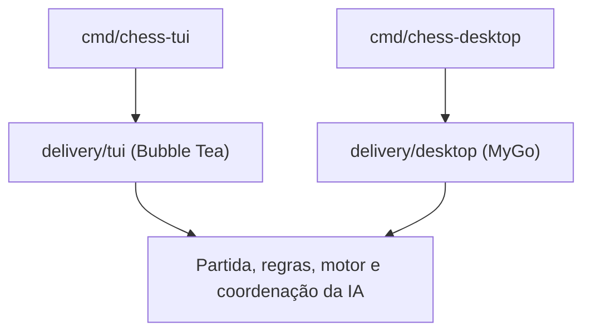
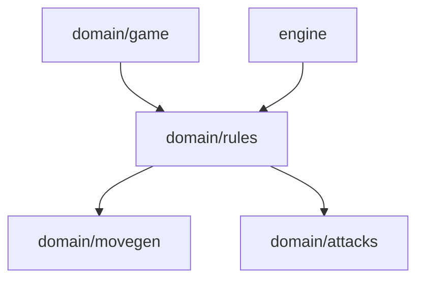

# Organização

[Documentação](README.md)

```text
cmd/
├── chess-tui/          # terminal entry point
└── chess-desktop/      # native desktop entry point
internal/
├── application/        # UI-independent AI coordination
│   └── tests/          # search lifecycle tests
├── architecture/
│   └── tests/          # package dependency checks
├── domain/             # pure chess types and rules; standard library only
│   ├── movegen/        # pseudolegal moves
│   ├── attacks/        # attacked squares
│   ├── rules/          # legal moves and position transitions
│   ├── game/           # game, snapshots, history and SAN
│   └── tests/          # domain tests
├── engine/             # AI evaluation and search
│   └── tests/          # search tests and benchmarks
└── delivery/
    ├── tui/            # Bubble Tea terminal interface
    │   ├── application/ # screens and sessions
    │   ├── match/       # interaction and search event adapter
    │   ├── render/      # presentation
    │   └── tests/       # interface tests
    └── desktop/        # MyGo native window and entry API
        ├── pages/      # screen selection and composition
        ├── components/ # widgets and interaction state
        └── tests/      # desktop interface tests
```

## Interfaces e núcleo compartilhado



Cada executável lê as flags e chama o pacote da sua interface. As setas
resumem as dependências entre as interfaces e o núcleo em `internal`.

### Terminal

`delivery/tui/application` coordena telas, sessões, eventos e animações.
`match` controla a interação com a partida, expõe cópias do estado em
`match.State` e adapta a busca da IA para `tea.Cmd`. A TUI cancela a busca
ao abrir o histórico ou o menu da partida e aguarda a escolha da peça antes
de iniciar uma busca quando há uma promoção pendente.

`render` usa snapshots e resultados de `domain/game` para desenhar a interface.
Medidas, cores e quadros de animação ficam nesse pacote. Cada opção de menu
reúne seu rótulo e sua ação em `delivery/tui/application/menus.go`.
`tui.NewModel` e `tui.NewModelWithAI` expõem o modelo de partida para uso
direto, com navegação de telas disponível em `tui.NewApplication`.

### Desktop

`desktop.Run` abre a janela nativa do MyGo e conecta `Window.Update` ao
estado da interface. `pages` seleciona e monta as telas de menu, configuração
e partida. `components` desenha o tabuleiro, as barras dos jogadores, a
lateral e os diálogos. O estado nesse pacote controla seleção, arraste,
promoção e consulta do histórico, usando `domain/game` para validar jogadas
e manter a partida.

O desktop cria a IA em `components` com `engine.NewPlayer`, executa a
busca em uma goroutine e entrega o resultado à thread da interface por
`Window.Update`, que também atualiza o desenho.

### Coordenação da IA

As duas interfaces usam `internal/application.Opponent` para iniciar e cancelar
buscas e descartar respostas duplicadas ou de buscas e sessões anteriores.
`Start` devolve uma função para a interface executar em segundo plano.
A interface chama `Start`, `Stop` e `Accept` no seu loop de eventos.
`Accept` aplica a resposta por `Game.Play`, que valida a jogada.

`domain.MoveChooser` define o contrato `ChooseMove(context.Context, Position)`.
`engine.Player` implementa esse contrato, e `tui.NewModelWithAI` também aceita
estratégias próprias. O pacote `match` depende desse contrato e delega o ciclo
de busca a `Opponent`.

## Motor e regras

Cada seta mostra um import direto. Os cinco pacotes do diagrama também
importam a base `internal/domain`, que define os tipos, o tabuleiro e a posição.



O pacote base `domain` usa apenas a biblioteca padrão. `rules` filtra movimentos
e determina a situação de uma posição. `game` mantém o estado da partida, os
resultados, as repetições e os snapshots que servem de base para a notação SAN.
`engine` simula posições pelas regras e devolve a jogada escolhida à interface.

`Board` contém um array fixo. `Position` contém somente valores, então copiar a
posição também copia suas 64 casas, sem alocar slices ou compartilhar ponteiros.
`rules.PositionAfterMove` valida e devolve uma nova posição. A busca usa
`PositionAfterLegalMove` somente com movimentos legais gerados para aquela posição.

`NewPosition` permite construir posições editáveis. `Position.Validate` verifica
peças, reis, contadores, direitos de roque e metadados de en passant; não comprova
que a posição pode ser alcançada numa partida legal. O motor valida a entrada
uma vez antes da busca, sem repetir essa verificação em cada posição simulada.

## Fronteiras de dependência

O motor e a coordenação da IA funcionam independentemente das interfaces.
`internal/application` usa o domínio e a biblioteca padrão. A TUI e o desktop
têm árvores de pacotes independentes. Os testes ficam nas pastas `tests` e
usam as APIs públicas dos pacotes que verificam.

`internal/architecture/tests` verifica os imports de todos os arquivos Go de
produção, incluindo arquivos específicos de outras plataformas. O teste protege
as fronteiras acima e exige declarar as dependências de novos pacotes. Ele roda
com `go test ./...`, inclusive no CI, sem ferramentas adicionais.

Para conferir os imports reais, sem incluir dependências exclusivas dos testes:

```sh
go list -f '{{.ImportPath}} {{.Imports}}' ./cmd/... ./internal/...
```
