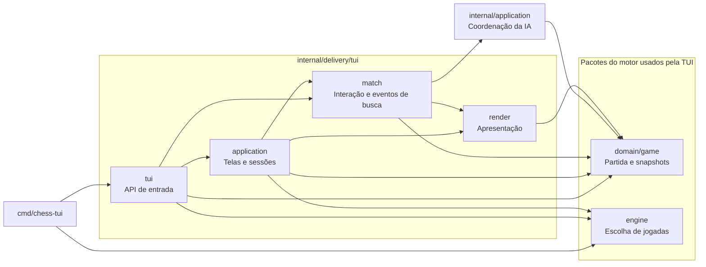
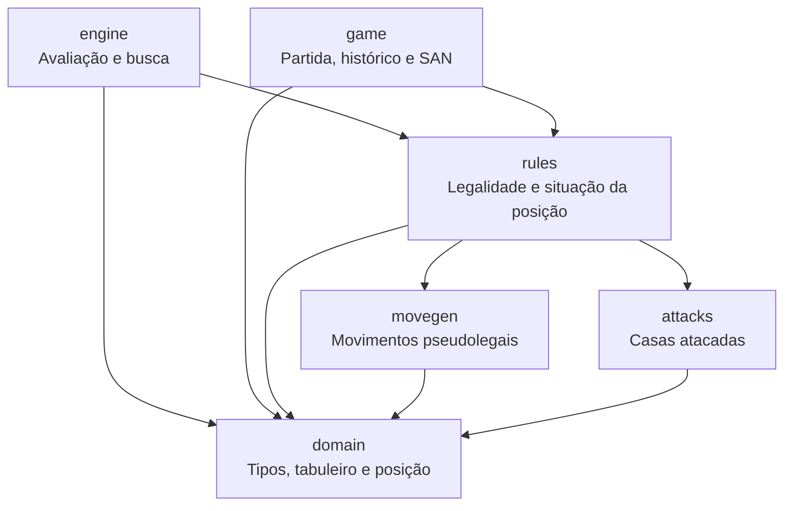

# Organização

[Documentação](README.md)

```text
cmd/
└── chess-tui/          # CLI entry point
internal/
├── application/        # UI-independent AI coordination
│   └── tests/          # search lifecycle tests
├── architecture/
│   └── tests/          # package dependency checks
├── domain/             # pure chess types and rules; standard library only
│   ├── movegen/        # pseudolegal moves
│   ├── attacks/        # attacked squares
│   ├── rules/          # legal moves and position transitions
│   ├── game/           # game, snapshots, history and SAN
│   └── tests/          # domain tests
├── engine/             # AI evaluation and search
│   └── tests/          # search tests and benchmarks
└── delivery/
    └── tui/            # terminal interface and entry API
        ├── application/ # screens and sessions
        ├── match/       # interaction and search event adapter
        ├── render/      # presentation
        └── tests/       # interface tests
```

### Interface e controle da partida

`cmd/chess-tui` interpreta as flags e chama a API de entrada em `tui`.
`delivery/tui/application` coordena as telas e as sessões; `match` controla a interação com
a partida e adapta os eventos de busca. `internal/application.Opponent` coordena
o ciclo da IA sem depender do Bubble Tea. `render` transforma dados em conteúdo de
terminal, sem executar jogadas ou iniciar buscas.

As setas abaixo representam imports internos. A vista omite somente os imports
do pacote base `domain`, usado diretamente pelos pacotes de entrada,
interface e coordenação da IA.



O pacote `tui` também oferece `NewModel` e `NewModelWithAI`, que expõem o modelo
de `match` sem a navegação de telas de `application`; por isso ele importa
`match` e `game` diretamente. `tui` e o executável importam `engine` para
configurar a dificuldade. `render` importa `game` para apresentar snapshots
e resultados, mas não depende das regras nem da busca.

A interface `domain.MoveChooser` define `ChooseMove(context.Context, Position)`.
`engine.Player` implementa esse contrato; `tui.NewModelWithAI` recebe qualquer
implementação, inclusive estratégias próprias. `internal/application.Opponent`
aplica a resposta por `Game.Play`, que valida a jogada antes de alterar a partida.
O pacote `match` não importa `engine`.

`Opponent.Start` devolve uma função de busca para execução em segundo plano;
`Start`, `Stop` e `Accept` devem ser chamados no loop de eventos da interface.
A coordenação cancela buscas e descarta respostas duplicadas, de buscas anteriores
ou de outras sessões. A TUI decide quando pausar para histórico, menus ou promoção
e converte a função de busca em `tea.Cmd`. A camada de aplicação depende somente
do domínio e da biblioteca padrão; não cria goroutines nem contém mensagens visuais.

`Board` contém um array fixo, e `Position` contém somente valores: copiar a
posição também copia suas 64 casas, sem alocar slices ou compartilhar ponteiros.
`rules.PositionAfterMove` valida e devolve uma nova posição. A busca usa
`PositionAfterLegalMove` somente com movimentos legais gerados para aquela posição.

`NewPosition` permite construir posições editáveis. `Position.Validate` verifica
peças, reis, contadores, direitos de roque e metadados de en passant; não comprova
que a posição pode ser alcançada numa partida legal. O motor valida a entrada
uma vez antes da busca, sem repetir essa verificação em cada posição simulada.

### Motor e regras

Todos os nomes desta vista pertencem a `internal/domain` e `internal/engine`. Aqui estão todos os
imports internos desses pacotes, incluindo as dependências dos tipos base.



O pacote base `domain` contém os dados compartilhados e não importa outros pacotes
do projeto. `rules` filtra movimentos e determina a situação de uma posição;
`game` mantém o estado da partida, os resultados e as repetições. `engine` simula
posições pelas regras e devolve uma jogada, sem modificar a partida real.

Cada opção de menu reúne seu rótulo e sua ação em `application/menus.go`;
o desenho e o comando executado usam a mesma definição. A configuração mantém
dificuldades tipadas, e as escolhas de promoção vêm dos movimentos da partida.
`match.State` fornece cópias dos dados de interação, enquanto medidas, cores,
componentes e quadros de animação pertencem a `render`. A notação SAN pertence a
`domain/game`, junto dos snapshots que descreve; o renderer não consulta regras.
O pacote `delivery/tui/application` coordena eventos, telas e o agendamento das animações.

O motor não importa a TUI. `application`, `match` e `render` não importam a raiz
`tui`, e nenhum pacote de produção importa os testes. Os testes ficam nas pastas
`tests` e dependem das APIs públicas dos pacotes que verificam.

`internal/architecture/tests` verifica os imports de todos os arquivos Go de
produção, incluindo arquivos específicos de outras plataformas. O teste protege
as fronteiras acima e exige declarar as dependências de novos pacotes. Ele roda
com `go test ./...`, inclusive no CI, sem ferramentas adicionais.

Para conferir os imports reais, sem incluir dependências exclusivas dos testes:

```sh
go list -f '{{.ImportPath}} {{.Imports}}' ./cmd/... ./internal/...
```
